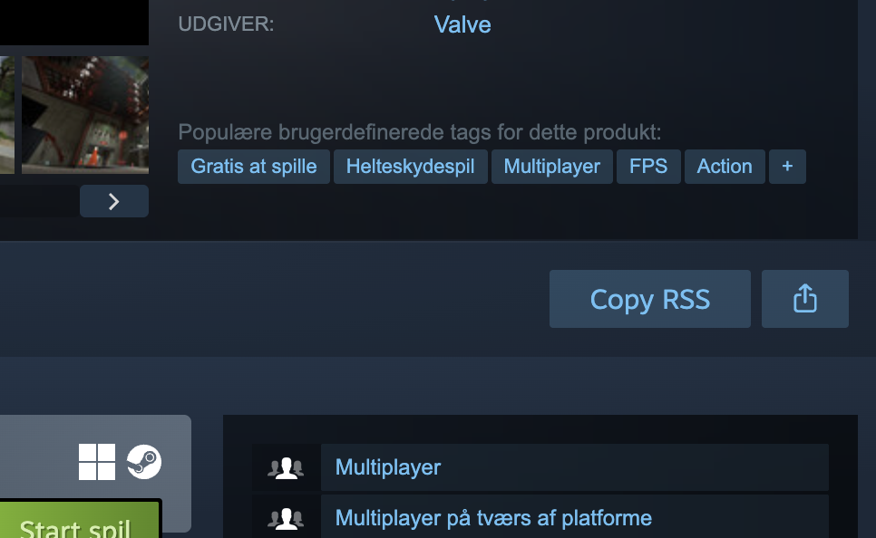

<p align="center">
  
</p>

<p align="center">
  <a href="README.md">English</a> · <a href="README.uk.md">Українська</a> · <b>Español</b>
</p>

<p align="center">
  <strong>Sigue las noticias de tus juegos de Steam en tu lector de RSS.</strong><br>
  Una extensión para Chrome que añade el botón <b>Copy RSS</b> junto a <b>Compartir</b> en las páginas de juegos de Steam.
</p>

<p align="center">
  
  
  
  <a href="https://github.com/Agn0st/steam-rss-grabber/releases/latest"></a>
  
</p>

<p align="center">
  
  
  <a href="LICENSE"></a>
</p>

<p align="center">
  <a href="https://github.com/Agn0st/steam-rss-grabber/releases/latest"></a>
</p>

<p align="center">
  <a href="#instalación">Instalación</a> · <a href="#uso">Uso</a> · <a href="#cómo-funciona">Cómo funciona</a> · <a href="#permisos-y-privacidad">Privacidad</a>
</p>

<p align="center">
  
  <br>
  <sub>Ejemplo en la página de un juego de Steam sin iniciar sesión.</sub>
</p>

## Instalación

1. Descarga el ZIP de la extensión desde [GitHub Releases](https://github.com/Agn0st/steam-rss-grabber/releases/latest) y descomprímelo.
2. Abre `chrome://extensions` en Google Chrome y activa el **Modo de desarrollador** (**Developer mode**).
3. Haz clic en **Cargar descomprimida** (**Load unpacked**) y selecciona la carpeta `extension` que contiene `manifest.json`.
4. Abre o recarga la página de un juego en Steam.

También puedes cargar la carpeta [`extension/`](extension/) desde un clon o
un archivo del código fuente. Chrome lee los archivos directamente desde esa
carpeta. Consérvala en el mismo lugar y, después de actualizar los archivos,
recarga la extensión desde `chrome://extensions`.

## Uso

1. Abre la página de un juego en la tienda de Steam.
2. Haz clic en **Copy RSS**, al lado de **Compartir**.
3. Cuando aparezca **Copied**, pega el enlace en tu lector de RSS.

El enlace incluye el identificador del juego en Steam y el idioma del feed. Por ejemplo:

```text
https://store.steampowered.com/feeds/news/app/620/?l=spanish
```

> [!NOTE]
> Tu lector de RSS gestiona las suscripciones, las actualizaciones y las notificaciones. La disponibilidad de las noticias y sus traducciones depende de Steam y de la editora del juego.

<br>

## Cómo funciona

<table>
  <tr>
    <td width="50%" valign="top"><h3>📡 Un feed por juego</h3><p>La extensión toma el identificador del juego de la URL de la tienda y genera el enlace a su feed RSS.</p></td>
    <td width="50%" valign="top"><h3>📋 Copia con un clic</h3><p>El botón usa el estilo de Steam y muestra brevemente <b>Copied</b> o <b>Copy failed</b> tras pulsarlo.</p></td>
  </tr>
  <tr>
    <td width="50%" valign="top"><h3>🌐 Idioma de la página</h3><p>La extensión solicita el feed en el idioma de la página de Steam. Si el idioma no se reconoce, usa el inglés.</p></td>
    <td width="50%" valign="top"><h3>👤 Funciona sin iniciar sesión</h3><p>El botón aparece junto a Compartir en las páginas compatibles, incluso si no has iniciado sesión en Steam.</p></td>
  </tr>
</table>

## Permisos y privacidad

La extensión solo se ejecuta en `https://store.steampowered.com/app/*`. Usa el
permiso `clipboardWrite` para copiar el enlace al pulsar **Copy RSS**. La
extensión no lee el portapapeles, no recopila datos de uso ni hace solicitudes
de red.

## Compatibilidad

Steam RSS Grabber está diseñado para Google Chrome. El botón depende de la
estructura de la tienda de Steam y aparece cuando está disponible el botón
**Compartir**.

## Estructura del proyecto

- [`extension/manifest.json`](extension/manifest.json) declara Manifest V3, las páginas compatibles y el permiso para escribir en el portapapeles.
- [`extension/content.js`](extension/content.js) añade el botón y genera el enlace RSS.

## Licencia

[MIT](LICENSE). Steam RSS Grabber es un proyecto independiente sin afiliación con Valve ni Steam.
