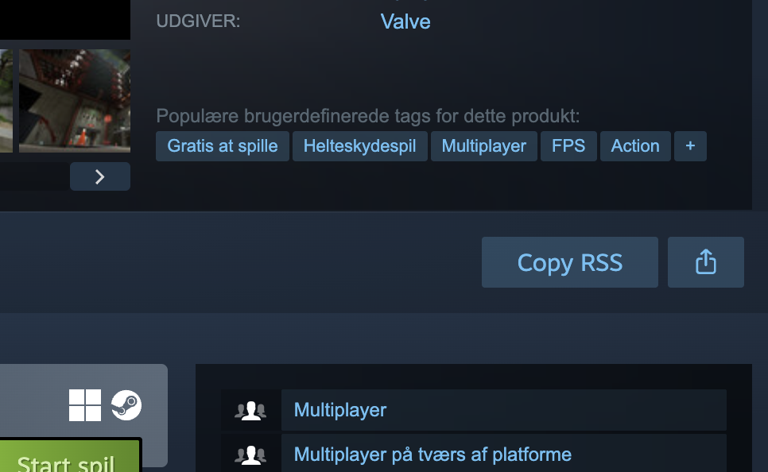

<p align="center">
  
</p>

<p align="center">
  <b>English</b> · <a href="README.uk.md">Українська</a> · <a href="README.es.md">Español</a>
</p>

<p align="center">
  <strong>Follow any Steam game's news in your RSS reader.</strong><br>
  A Chrome extension that adds a <b>Copy RSS</b> button next to <b>Share</b> on Steam game pages.
</p>

<p align="center">
  
  
  
  <a href="https://github.com/Agn0st/steam-rss-grabber/releases/latest"></a>
  
</p>

<p align="center">
  
  
  <a href="LICENSE"></a>
</p>

<p align="center">
  <a href="https://github.com/Agn0st/steam-rss-grabber/releases/latest"></a>
</p>

<p align="center">
  <a href="#installation">Installation</a> · <a href="#usage">Usage</a> · <a href="#how-it-works">How it works</a> · <a href="#permissions-and-privacy">Privacy</a>
</p>

<p align="center">
  
  <br>
  <sub>Example on a Steam game page while signed out.</sub>
</p>

## Installation

1. Download the extension ZIP from [GitHub Releases](https://github.com/Agn0st/steam-rss-grabber/releases/latest) and extract it.
2. Open `chrome://extensions` in Google Chrome and turn on **Developer mode**.
3. Click **Load unpacked** and select the extracted `extension` folder containing `manifest.json`.
4. Open or reload a Steam game page.

You can also load the [`extension/`](extension/) folder from a clone or source archive. Chrome loads the files directly. Keep the folder in place and use the reload button on `chrome://extensions` after replacing its files.

## Usage

1. Open a game's Steam store page.
2. Click **Copy RSS** next to **Share**.
3. When the button says **Copied**, paste the URL into your RSS reader.

A copied URL includes the Steam app ID and the feed language. For example:

```text
https://store.steampowered.com/feeds/news/app/620/?l=english
```

> [!NOTE]
> Your RSS reader handles subscriptions, updates, and notifications. Steam and the game's publisher determine which news items and translations are available.

<br>

## How it works

<table>
  <tr>
    <td width="50%" valign="top"><h3>📡 One feed per game</h3><p>The extension uses the app ID in the store URL to build the RSS link for that game.</p></td>
    <td width="50%" valign="top"><h3>📋 One-click copy</h3><p>The button uses Steam's styling and briefly shows <b>Copied</b> or <b>Copy failed</b> after a click.</p></td>
  </tr>
  <tr>
    <td width="50%" valign="top"><h3>🌐 Follows the page language</h3><p>The RSS link requests the Steam page's language. Unknown locales fall back to English.</p></td>
    <td width="50%" valign="top"><h3>👤 Works signed out</h3><p>The button appears beside Share on supported game pages, including when you're signed out.</p></td>
  </tr>
</table>

## Permissions and privacy

The extension runs only on `https://store.steampowered.com/app/*`. It uses
`clipboardWrite` to copy the feed URL when you click **Copy RSS**. It does not
read the clipboard, collect analytics, or make network requests.

## Compatibility

Steam RSS Grabber targets Google Chrome. The button depends on Steam's store
page markup and appears when the **Share** control is available.

## Project layout

- [`extension/manifest.json`](extension/manifest.json) declares Manifest V3, the page scope, and clipboard permission.
- [`extension/content.js`](extension/content.js) adds the button and builds the RSS URL.

## License

[MIT](LICENSE). Steam RSS Grabber is an unofficial project independent of Valve and Steam.
