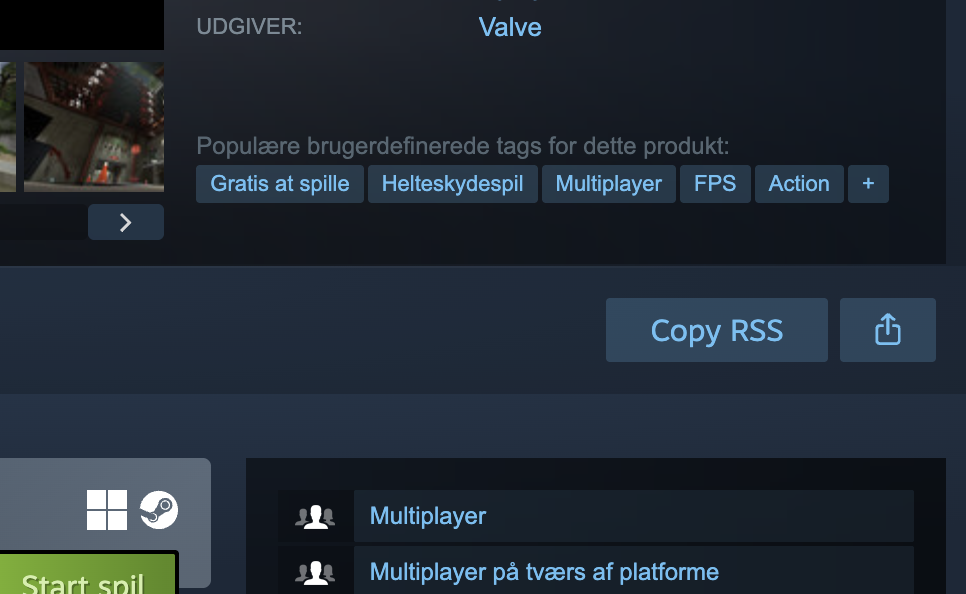

<p align="center">
  
</p>

<p align="center">
  <a href="README.md">English</a> · <b>Українська</b> · <a href="README.es.md">Español</a>
</p>

<p align="center">
  <strong>Стеж за новинами ігор Steam у своєму RSS-ридері.</strong><br>
  Розширення для Chrome додає кнопку <b>Copy RSS</b> поруч із кнопкою «Поділитися» на сторінках ігор Steam.
</p>

<p align="center">
  
  
  
  <a href="https://github.com/Agn0st/steam-rss-grabber/releases/latest"></a>
  
</p>

<p align="center">
  
  
  <a href="LICENSE"></a>
</p>

<p align="center">
  <a href="https://github.com/Agn0st/steam-rss-grabber/releases/latest"></a>
</p>

<p align="center">
  <a href="#встановлення">Встановлення</a> · <a href="#використання">Використання</a> · <a href="#як-це-працює">Як це працює</a> · <a href="#дозволи-та-приватність">Приватність</a>
</p>

<p align="center">
  
  <br>
  <sub>Приклад сторінки гри в Steam без входу в акаунт.</sub>
</p>

## Встановлення

1. Завантаж ZIP розширення з [GitHub Releases](https://github.com/Agn0st/steam-rss-grabber/releases/latest) і розпакуй його.
2. Відкрий `chrome://extensions` у Google Chrome й увімкни **Режим розробника** (**Developer mode**).
3. Натисни **Завантажити розпаковане розширення** (**Load unpacked**) і вибери папку `extension`, у якій є `manifest.json`.
4. Відкрий або перезавантаж сторінку гри в Steam.

Також можна завантажити папку [`extension/`](extension/) із локальної копії
репозиторію або архіву вихідного коду. Chrome читає файли безпосередньо з цієї
папки. Залиш її на місці, а після заміни файлів натисни кнопку перезавантаження
розширення на `chrome://extensions`.

## Використання

1. Відкрий сторінку гри в магазині Steam.
2. Натисни **Copy RSS** поруч із кнопкою **Поділитися**.
3. Коли з’явиться **Copied**, встав посилання у свій RSS-ридер.

Скопійоване посилання містить ідентифікатор гри в Steam і мову стрічки. Наприклад:

```text
https://store.steampowered.com/feeds/news/app/620/?l=ukrainian
```

> [!NOTE]
> Підписками, оновленнями й сповіщеннями керує твій RSS-ридер. Доступність новин і перекладів залежить від Steam та видавця гри.

<br>

## Як це працює

<table>
  <tr>
    <td width="50%" valign="top"><h3>📡 Стрічка для кожної гри</h3><p>Розширення бере ідентифікатор гри з адреси сторінки й формує посилання на її RSS-стрічку.</p></td>
    <td width="50%" valign="top"><h3>📋 Копіювання в один клік</h3><p>Кнопка використовує стилі Steam і після натискання на мить показує <b>Copied</b> або <b>Copy failed</b>.</p></td>
  </tr>
  <tr>
    <td width="50%" valign="top"><h3>🌐 Мова сторінки Steam</h3><p>Розширення запитує стрічку мовою сторінки. Для невідомих мовних налаштувань використовує англійську.</p></td>
    <td width="50%" valign="top"><h3>👤 Працює без входу</h3><p>Кнопка з’являється поруч із кнопкою «Поділитися» на підтримуваних сторінках, навіть якщо ти не ввійшов у Steam.</p></td>
  </tr>
</table>

## Дозволи та приватність

Розширення працює лише на сторінках `https://store.steampowered.com/app/*`.
Дозвіл `clipboardWrite` дає змогу скопіювати адресу стрічки після натискання
**Copy RSS**. Розширення не читає буфер обміну, не збирає аналітику й не надсилає
мережевих запитів.

## Сумісність

Steam RSS Grabber призначений для Google Chrome. Кнопка залежить від розмітки
магазину Steam і з’являється, коли на сторінці є кнопка «Поділитися».

## Структура проєкту

- [`extension/manifest.json`](extension/manifest.json) визначає Manifest V3, адреси сторінок і дозвіл на запис у буфер обміну.
- [`extension/content.js`](extension/content.js) додає кнопку й формує RSS-посилання.

## Ліцензія

[MIT](LICENSE). Steam RSS Grabber — незалежний проєкт, який не пов’язаний із Valve чи Steam.
